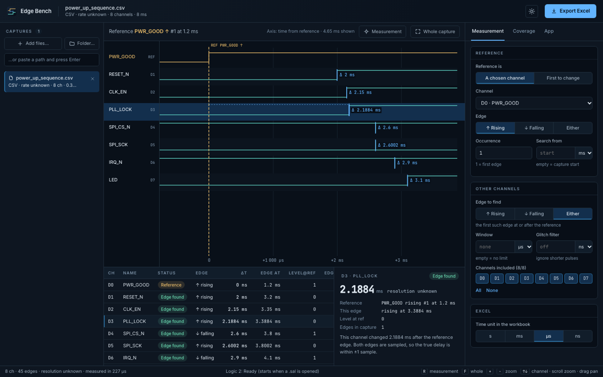
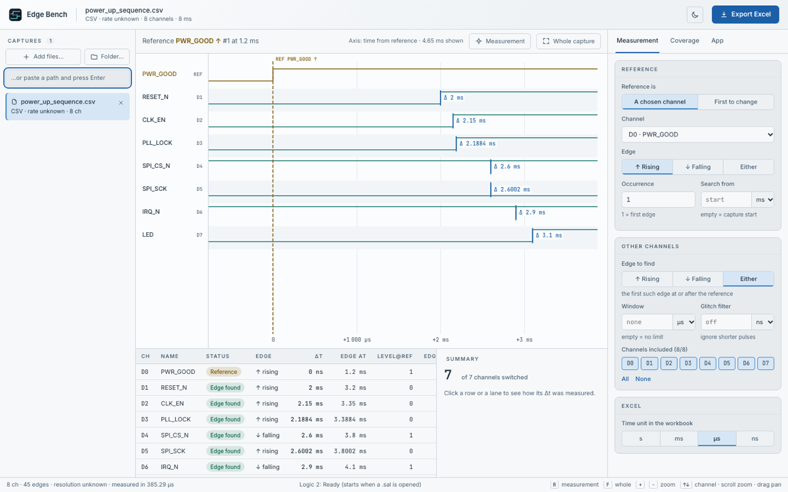
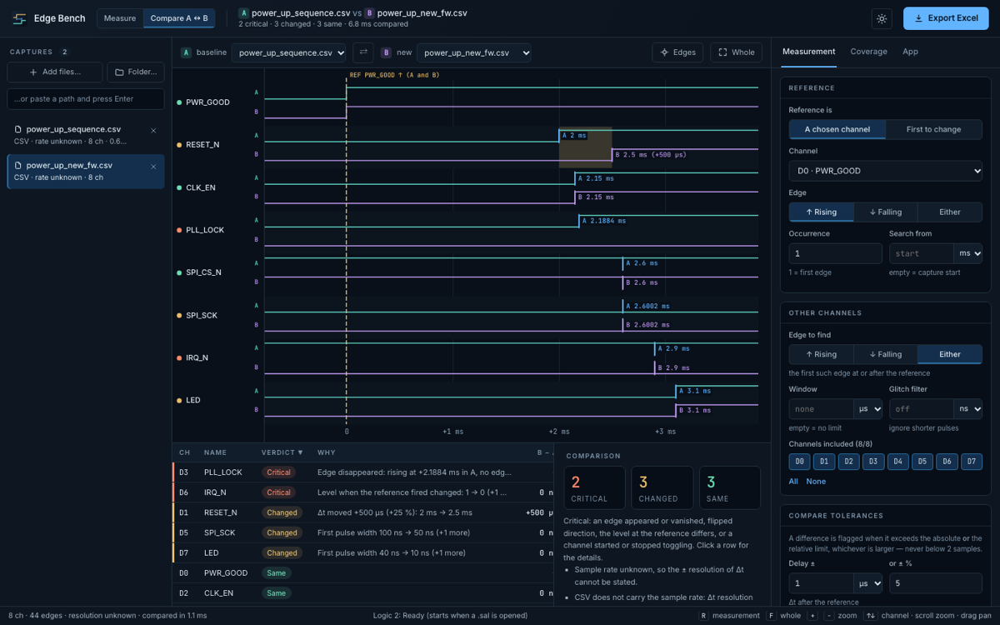

# Edge Bench

**Saleae Logic 2 edge timing, straight to Excel.** Open `.sal` captures, pick a
reference channel and edge (or let the app take the first channel that
changes), and Edge Bench reports the delay to the first edge on every other
channel. It shows the result as a table, as a waveform that marks the edges it
picked, and as an Excel workbook.




## Why not CSV

The CSV export writes one text row whenever any channel changes, so long
captures turn into huge files. Edge Bench has Logic 2 export **binary** data
in the background instead (8 bytes per edge per channel), memory-maps it, and
binary-searches it. Measured on this Mac (`scripts/benchmark.py`): a 60 s
capture, 16 channels at 100 MS/s, 5.86 million edges:

| Path | Time | Size |
|---|---|---|
| Logic 2 CSV export | 17.5 s | 263 MB |
| …then reading that CSV (pandas) | 62.2 s | |
| **Edge Bench, first open** (.sal → binary → memory map) | **2.0 s** | 47 MB |
| **Edge Bench, reopening** (cache) | **0.008 s** | |
| Measuring all 16 channels | 0.019 s | |

## What it measures

- **Reference:** a chosen channel's N-th rising / falling / either edge after
  an optional start time, **or** the first edge on any channel ("first to
  change").
- **Every other channel:** the first edge of the chosen kind *at or after*
  the reference. An edge in the same sample counts as Δt = 0.
- **Window:** edges later than the window are reported as "outside", together
  with where the next edge actually is.
- **Glitch filter:** pulses shorter than X are ignored. The edge reported is
  where the level settled, the same as Logic 2's own glitch filter, and the
  bounce length is kept.
- **Resolution:** each Δt is good to ±1 sample. That figure is shown next to
  every result and written to Excel. Numbers carry exactly the digits the
  sample rate supports (2.1884 ms at 10 ns, not 2.19 ms).
- **Excel** (`Export Excel`): the *Results* sheet (one row per channel,
  reference highlighted, misses marked), a *Batch matrix* (captures ×
  channels, when you export several captures), and a *Settings* sheet
  (everything needed to reproduce the numbers).

Inputs: `.sal` (needs Logic 2 installed; the app runs it in the background), a
Logic 2 binary export folder (`digital_N.bin`, format v0 and v1), or a Logic 2
digital CSV. Tested with the Logic 8, Logic Pro 8 and Logic Pro 16 (using Logic 2's
simulated devices).

## Compare two captures (A ↔ B)

Use this, for example, to check a new firmware against the released one before
it goes near hardware. Switch the header to **Compare A ↔ B**, then pick the
**baseline (A)** and the **new capture (B)**. Both get the same measurement,
and each is aligned on its own reference edge. Every channel is then marked:

| Verdict | When |
|---|---|
| **Critical** | an edge appeared or vanished; its direction flipped; the level when the reference fired differs; the channel started or stopped toggling |
| **Changed** | Δt, the first pulse width, the edge count, the time spent high (toggling channels only) or the shortest pulse moved beyond tolerance |
| **Same** | nothing beyond tolerance |

**Match channels** by number (D3 with D3) or **by name**. Use name matching
when probes were moved between captures: `RESET_N` on D1 in A is then compared
with `Reset_N` on D3 in B (case and extra spaces are ignored), the reference
follows its name, and the table shows `D1 ↔ D3`. A name found in only one
capture is listed as "Not in both".

Tolerances are "absolute or relative, whichever is larger", set separately
for delays (default ±1 µs / ±5 %) and pulse widths (±10 ns / ±10 %).
Differences of up to 2 sample periods are never flagged, because each edge
time is only good to ±1 sample. The view shows A (teal) above B (purple) in
every lane, with any shift shaded. The table lists the riskiest channels first
with the reason, and **Export Excel** writes a *Comparison* sheet plus both
captures' results and every setting used.



## Install

**Windows (work PCs).** On the Mac, run `scripts/make_windows_package.sh`. It
produces `dist/EdgeBench-<ver>-windows.zip` (1 MB, installs packages from the
internet) and `…-windows-offline.zip` (76 MB, carries every package, so no
internet or proxy is needed). Then on the PC:

1. Install **Python 3.12 or 3.13** (python.org) and **Saleae Logic 2**.
2. Unzip, then double-click `Create desktop shortcut.bat` (once).
3. Double-click **Edge Bench** on the desktop. The first start sets up a
   private `.venv`; after that it starts in a second or two.

**Updating (since 0.3.0).** Install once by hand as above; from then on,
updates go in place:

- **Update folder.** In *App → Updates → Choose update folder…* pick a folder
  every PC can reach, for example a network share. Copy each new
  `EdgeBench-<ver>-windows[-offline].zip` there, or let
  `scripts/release.sh <ver> --publish <folder>` do it. Edge Bench then shows
  **Update <ver>** in its header, along with *What's new* from `CHANGELOG.md`.
- **From a file.** Use *Install from a file…* in the app, or drag the zip onto
  `Update Edge Bench.bat`.
- **What happens.** The app quits, and the new version installs itself and
  passes its own start-up check before it stays. Any failure puts the old
  version back, and the app says why when it next opens. Python packages are
  reinstalled only when `requirements.txt` changed.
- **Rolling back.** *Roll back to <ver>* (or `Update Edge Bench.bat --rollback`)
  returns to the version before; doing it again goes forward.
- **What stays.** Settings, logs and the export cache live in the home folder,
  so an update never touches them. A file of your own in the install folder
  stays too: an update replaces only what the previous package listed in its
  `MANIFEST.json`.
- **From a git clone.** Use `git pull`. The launcher reinstalls changed
  packages and rebuilds the UI by itself.

**macOS:** `./install.sh`. This builds the UI, installs to
`~/.local/share/edge-bench`, and creates `~/Desktop/Apps/Edge Bench.command`
plus the ⏱ tile in App Launcher.

The app opens in your browser at `127.0.0.1` on a free port. Nothing leaves the
PC. Closing the tab leaves it running in the background; *App → Quit* stops it,
along with the Logic 2 it started.

## Develop

```bash
python3 -m venv .venv && .venv/bin/pip install -r requirements-dev.txt
cd ui && npm install && npm run build && cd ..
.venv/bin/python -m pytest -q          # core, API, compare, .sal reader, updater (167)
npm install && npx playwright test     # real UI, both themes, axe, fold probe (30)
.venv/bin/python main.py               # run from the repo
```

**Releasing.** Write the `## <ver> — <date>` section in `CHANGELOG.md` (users
see it as *What's new*), commit, then run `scripts/release.sh <ver> [--publish <folder>]`.
It refuses to release without that section, or from an uncommitted tree. It
then bumps the version, runs both test suites, builds the two Windows zips,
commits and tags `v<ver>`, and copies the zips to the update folder.

UI development with hot reload: `.venv/bin/python main.py --no-browser --port 8791`
plus `cd ui && npm run dev`. Layers, data flow, and "how to add a format / a
column / repeated cycles": [ARCHITECTURE.md](ARCHITECTURE.md). Plan:
[TODO.md](TODO.md).

## Large captures: a .sal is read directly

Since 0.2.0, Edge Bench reads the edges straight out of the `.sal`, the way
Logic 2 does, without Logic 2 and without an export. Each channel is unpacked
once into the cache. That takes about 1 to 3 bytes per edge on disk (the
binary export takes 8). From then on, only the part a measurement or the
screen needs is decoded: a 100-million-edge channel was measured in 12 ms.
The format is not documented by Saleae. It was decoded from Logic 2.4.48 and
is checked against Logic 2's own exports (see ARCHITECTURE.md). A file it does
not recognise is exported through Logic 2 as before, and the capture's notes
say so.

### Why the export route struggled

Logic 2 stores edges compactly: each one as a short difference from the
previous edge, in a zip (about 3.5 bytes per edge on simulated data, and much
less for a regular clock). It draws the screen from summaries and decodes only
what you look at. The binary export, which is the only way the Automation API
hands edges out, writes **8 bytes per edge** for the *whole* channel. There is
no time-range option.

So a channel with billions of edges gives an export of tens of GB, even when
the `.sal` is small. The usual causes are an **unconnected (floating) input**
on a real device (noise toggles it millions of times per second) and a fast
clock over a long capture. Turn unused channels off in Logic 2 before
capturing.

When the export route is still taken (a `.sal` the direct reader does not
know), Edge Bench memory-maps the export and only reads the edges it needs,
so the size costs disk space, not RAM. Since 0.1.3 the export is watched: its
size is shown while it is written, it stops before the disk fills, removing
the capture cancels it, and an error names the busiest channels. On Windows,
the Logic 2 that Edge Bench starts may use at most 60 % of the RAM.

## Limitations

- **Windows:** 0.1.0 crashed invisibly at start-up (cp1252); 0.1.1 started,
  but loading a capture failed, and a second attempt took a 64 GB PC to
  full RAM and 99 % CPU. 0.1.2: memory-bounded CSV reader, one instance
  per user, a memory guard, Logic 2's whole process tree closed on exit, and
  the launcher shows the app's address. 0.1.3: an export bigger than the
  cache limit evicted itself ("exported but would not open"). 0.2.0 reads
  `.sal` directly, so Logic 2 and its export are no longer in the way. Not
  yet run on a real-hardware capture. Beyond that:
  The `.bat` files, Explorer "Show in folder", the `Logic.exe` auto-detection
  and the offline wheel install all still need a first run on a real PC. The
  wheel sets were verified to resolve for CPython 3.12 and 3.13 / win_amd64.
- **Real hardware not tested:** every `.sal` test used Logic 2's simulated
  Logic 8 / Pro 8 / Pro 16 (Logic 2.4.48). The direct reader has not seen a
  run longer than ~1 M samples from Logic 2 itself, nor a Logic MSO file. Binary format **v1** (newer devices) is parsed from
  Saleae's published spec and tested on synthetic files only.
- **If another Logic 2 window is open on Windows**, a second automation
  instance may not start. On macOS two instances run side by side (tested).
  The fallback is Preferences → Automation → enable the server on port 10430;
  Edge Bench then uses that window.
- **Compare** pairs channels by number or by name. With names used twice in
  one capture, they are paired in channel order (and a note says so). It
  compares one reference event and summary numbers over the span (count, time
  high, shortest pulse), not every edge of a burst one by one.
- **One reference event per capture.** Repeated cycles with statistics, the
  "nearest edge" rule (negative Δt) and a per-channel edge kind are not built
  yet; see TODO.md.
- CSV and plain binary exports do not carry the sample rate, so their
  resolution is shown as unknown.
