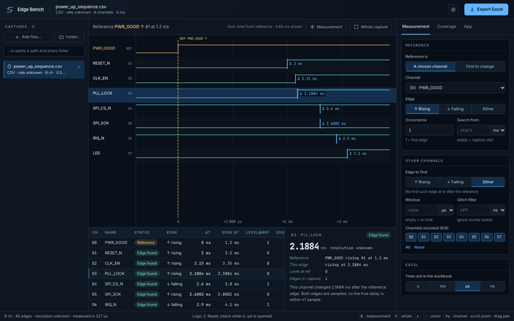
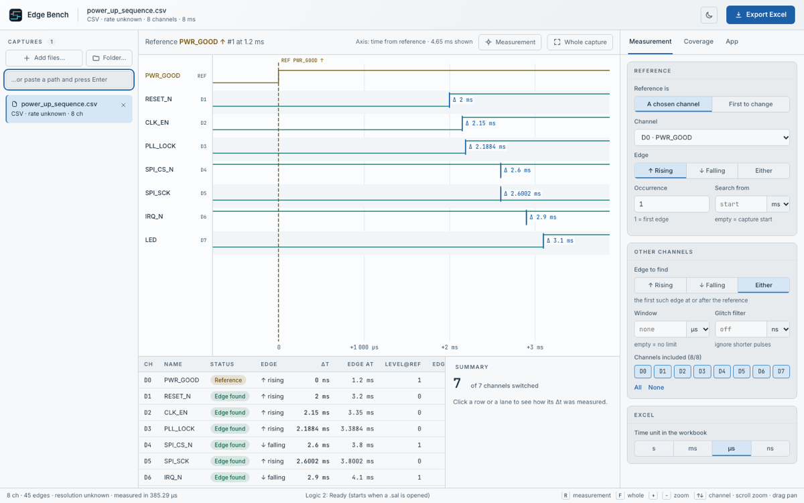

# Edge Bench

**Saleae Logic 2 edge timing, straight to Excel.** Open `.sal` captures, pick a
reference channel and edge (or let the app take the first channel that
changes), and Edge Bench reports the delay to the first edge on every other
channel. It shows the result as a table, as a waveform that marks the edges it
picked, and as an Excel workbook.




## Why not CSV

The CSV export writes one text row whenever any channel changes, so long
captures turn into huge files. Edge Bench has Logic 2 export **binary** data
in the background instead (8 bytes per edge per channel), memory-maps it, and
binary-searches it. Measured on this Mac (`scripts/benchmark.py`): a 60 s
capture, 16 channels at 100 MS/s, 5.86 million edges:

| Path | Time | Size |
|---|---|---|
| Logic 2 CSV export | 17.5 s | 263 MB |
| …then reading that CSV (pandas) | 62.2 s | |
| **Edge Bench, first open** (.sal → binary → memory map) | **2.0 s** | 47 MB |
| **Edge Bench, reopening** (cache) | **0.008 s** | |
| Measuring all 16 channels | 0.019 s | |

## What it measures

- **Reference:** a chosen channel's N-th rising / falling / either edge after
  an optional start time, **or** the first edge on any channel ("first to
  change").
- **Every other channel:** the first edge of the chosen kind *at or after*
  the reference. An edge in the same sample counts as Δt = 0.
- **Window:** edges later than the window are reported as "outside", together
  with where the next edge actually is.
- **Glitch filter:** pulses shorter than X are ignored. The edge reported is
  where the level settled, the same as Logic 2's own glitch filter, and the
  bounce length is kept.
- **Resolution:** each Δt is good to ±1 sample. That figure is shown next to
  every result and written to Excel. Numbers carry exactly the digits the
  sample rate supports (2.1884 ms at 10 ns, not 2.19 ms).
- **Excel** (`Export Excel`): the *Results* sheet (one row per channel,
  reference highlighted, misses marked), a *Batch matrix* (captures ×
  channels, when you export several captures), and a *Settings* sheet
  (everything needed to reproduce the numbers).

Inputs: `.sal` (needs Logic 2 installed; the app runs it in the background), a
Logic 2 binary export folder (`digital_N.bin`, format v0 and v1), or a Logic 2
digital CSV. Tested with the Logic 8, Logic Pro 8 and Logic Pro 16 (using Logic 2's
simulated devices).

## Install

**Windows (work PCs).** On the Mac, run `scripts/make_windows_package.sh`. It
produces `dist/EdgeBench-<ver>-windows.zip` (1 MB, installs packages from the
internet) and `…-windows-offline.zip` (76 MB, carries every package, so no
internet or proxy is needed). Then on the PC:

1. Install **Python 3.12 or 3.13** (python.org) and **Saleae Logic 2**.
2. Unzip, then double-click `Create desktop shortcut.bat` (once).
3. Double-click **Edge Bench** on the desktop. The first start sets up a
   private `.venv`; after that it starts in a second or two.

**macOS:** `./install.sh`. This builds the UI, installs to
`~/.local/share/edge-bench`, and creates `~/Desktop/Apps/Edge Bench.command`
plus the ⏱ tile in App Launcher.

The app opens in your browser at `127.0.0.1` on a free port. Nothing leaves the
PC. Closing the tab leaves it running in the background; *App → Quit* stops it,
along with the Logic 2 it started.

## Develop

```bash
python3 -m venv .venv && .venv/bin/pip install -r requirements-dev.txt
cd ui && npm install && npm run build && cd ..
.venv/bin/python -m pytest -q          # core + API + Logic 2 end-to-end (52)
npm install && npx playwright test     # real UI, both themes, axe, fold probe (16)
.venv/bin/python main.py               # run from the repo
```

UI development with hot reload: `.venv/bin/python main.py --no-browser --port 8791`
plus `cd ui && npm run dev`. Layers, data flow, and "how to add a format / a
column / repeated cycles": [ARCHITECTURE.md](ARCHITECTURE.md). Plan:
[TODO.md](TODO.md).

## Limitations

- **Windows: written, packaged and checked on a Mac, never run on Windows.**
  The `.bat` files, Explorer "Show in folder", the `Logic.exe` auto-detection
  and the offline wheel install all still need a first run on a real PC. The
  wheel sets were verified to resolve for CPython 3.12 and 3.13 / win_amd64.
- **Real hardware not tested:** every `.sal` test used Logic 2's simulated
  Logic 8 / Pro 8 / Pro 16. Binary format **v1** (newer devices) is parsed from
  Saleae's published spec and tested on synthetic files only.
- **If another Logic 2 window is open on Windows**, a second automation
  instance may not start. On macOS two instances run side by side (tested).
  The fallback is Preferences → Automation → enable the server on port 10430;
  Edge Bench then uses that window.
- **One reference event per capture.** Repeated cycles with statistics, the
  "nearest edge" rule (negative Δt) and a per-channel edge kind are not built
  yet; see TODO.md.
- CSV and plain binary exports do not carry the sample rate, so their
  resolution is shown as unknown.
